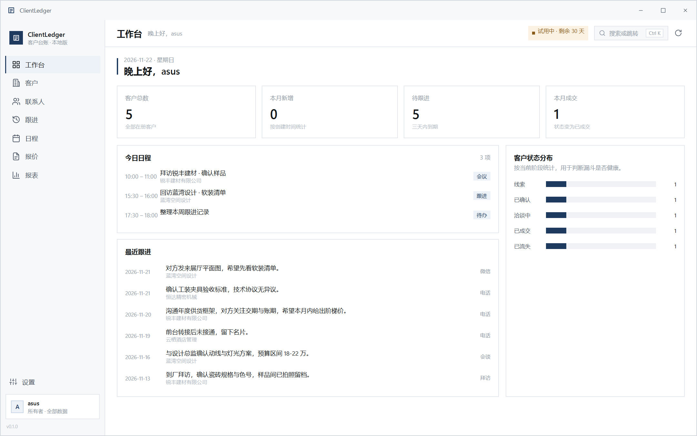
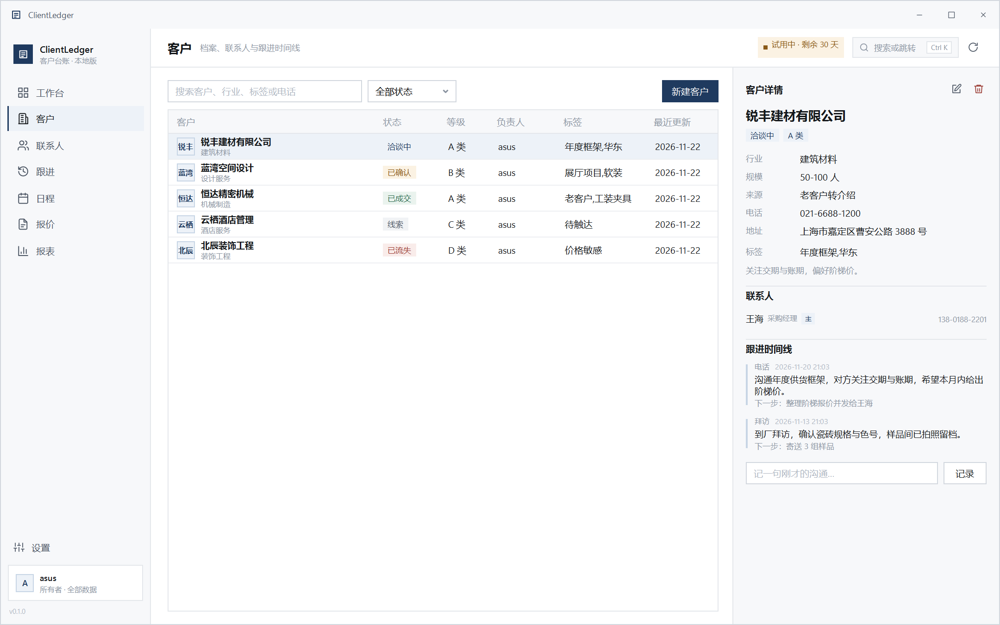

# ClientLedger · 客户台账

本地优先的桌面 CRM。数据只存在本机 SQLite，不需要服务器、不需要注册账号；交付形态是单个自包含 EXE。

| 工作台 | 客户 |
| --- | --- |
|  |  |

## 为什么是本地优先

- 客户数据不出本机，不做云端同步
- 断网可用
- 数据是一个 SQLite 文件，可直接备份、迁移、归档
- 删除程序不会删除数据

## 功能

业务模块（CRM）：

- 客户档案：行业、规模、来源、等级、阶段、负责人、标签
- 联系人：归属客户、职务、电话 / 邮箱 / 微信、主联系人
- 跟进记录：方式、时间、摘要、下一步、下次跟进；客户页内可快速记录
- 日程提醒：待办 / 会议 / 跟进、提前提醒、完成状态
- 简单报价：明细行、行折扣、整单折扣、税额、状态流转
- 基础报表：客户漏斗、跟进活跃度、报价转化、成交趋势

平台底座（与 CRM 解耦，可复用到其它业务模块）：

- 权限：权限令牌 + 4 角色（所有者 / 主管 / 业务员 / 只读）+ 数据范围（全部 / 仅本人负责）
- 审计：只追加日志，业务写入与审计落在同一个 SQLite 事务
- 授权：离线 ECDSA 许可证、30 天试用、时钟回拨检测
- 数据：自研迁移引擎、WAL、退出时合并 WAL、备份
- Shell：自绘标题栏、Paper 浅色主题、命令面板（Ctrl+K）、设置页

## 下载与安装

从 [Releases](https://github.com/karlmoriaty/ClientLedger/releases) 下载 `ClientLedger-<version>-win-x64.exe`。

- Windows 10 / 11 x64
- 免安装 .NET 运行时（自包含单文件，约 60 MB）
- 首次启动写入示例数据，可在「设置 → 数据」一键清除
- 数据位置：`%LocalAppData%\ClientLedger\data\clientledger.db`

当前更新方式是到 Releases 页面手动下载新版本；自动更新（Velopack）在路线图中。

## 关于试用与许可证

Release 构建内置 30 天全功能试用与离线许可证校验，用于演示"买断 + 离线授权"的分发形态。

本项目采用 MIT 许可证，你可以自行编译、修改，或在你的分发中移除这套授权逻辑。

## 从源码运行

环境：.NET 10 SDK

```bash
dotnet run --project src/ClientLedger.App
```

## 构建单文件 EXE

```bash
dotnet publish src/ClientLedger.App -c Release -r win-x64 --self-contained true \
  -p:PublishSingleFile=true -p:IncludeNativeLibrariesForSelfExtract=true \
  -p:EnableCompressionInSingleFile=true -o publish/win-x64
```

## 测试

```bash
dotnet test tests/ClientLedger.Tests
```

34 个测试覆盖报价计算、许可证验签、角色权限、迁移幂等、审计同事务、数据范围、试用到期与时钟回拨。

## 项目结构

```text
src/
  ClientLedger.App/               WPF 宿主：组合根、单实例、全局异常
  ClientLedger.Foundation/        模块契约与平台原语
  ClientLedger.Data/              SQLite、迁移、工作单元、审计
  ClientLedger.Security/          权限令牌、角色、数据范围
  ClientLedger.Licensing/         许可证验签与试用
  ClientLedger.Shell/             UI Shell、主题、对话框、命令面板
  ClientLedger.Modules.Crm/       CRM 模块（第一个业务模块）
  ClientLedger.Modules.Crm.Contracts/
tools/
  ClientLedger.LicenseForge/      许可证签发工具（私钥不入库）
tests/
  ClientLedger.Tests/
```

新增业务模块只需实现 `IModule`：

```csharp
public interface IModule
{
    ModuleManifest Manifest { get; }
    void ConfigureServices(IServiceCollection services, IModuleContext context);
    void RegisterNavigation(INavigationRegistry registry);
    IReadOnlyList<Uri> ResourceDictionaryUris => [];
}
```

宿主无需改动即可加载。模块自带表和迁移脚本，用表前缀隔离，迁移按模块独立记账。

## 路线图

- 自动更新：接入 Velopack，支持增量更新与更新通道
- 报价 PDF / 打印
- CSV 导入导出与备份还原
- 深色主题
- 一个真实垂直模块示例，验证扩展点

## 贡献

欢迎提 Issue 和 PR。提交前请确保 `dotnet test` 全绿。

## 许可证

MIT License，见 [LICENSE](LICENSE)。

## 作者

karlmoriaty · [github.com/karlmoriaty](https://github.com/karlmoriaty)